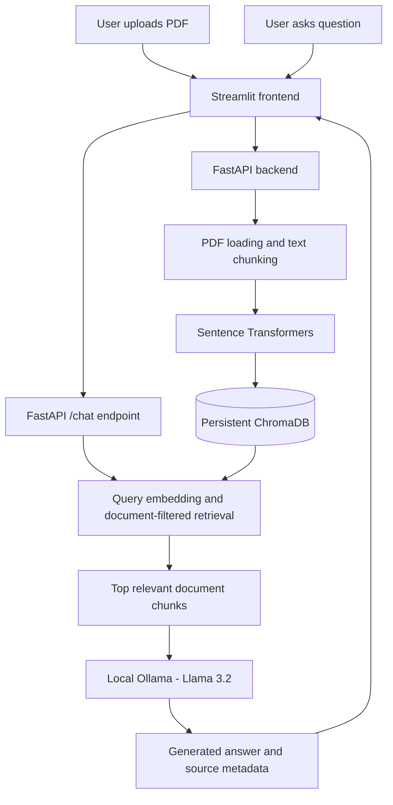
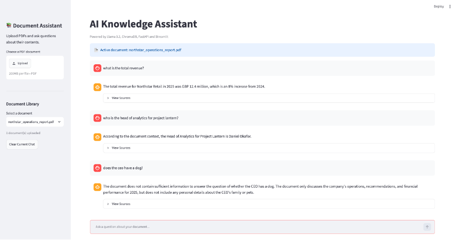

# RAG Knowledge Assistant

A fully local **Retrieval-Augmented Generation (RAG) chatbot** that enables users to upload PDF documents and ask natural-language questions about their contents.

Built using **Python, LangChain, FastAPI, Streamlit, ChromaDB, Sentence Transformers, and Ollama**, the application combines semantic document retrieval with local large language model inference to generate context-grounded answers with source page references.

The project demonstrates an end-to-end RAG workflow, including document ingestion, vector search, LLM integration, REST API development, containerisation, automated testing, CI/CD, and evaluation.

**No paid LLM API or cloud infrastructure is required.**

## Features

- Upload and process PDF documents through a Streamlit interface.
- Extract text and split documents into overlapping chunks using LangChain.
- Generate semantic embeddings with `all-MiniLM-L6-v2`.
- Store document embeddings and metadata in persistent ChromaDB storage.
- Perform semantic similarity search within a selected document.
- Generate context-grounded answers using Llama 3.2 (3B) through Ollama.
- Display retrieved source information and page references.
- Switch between uploaded documents.
- Maintain separate session-based conversation histories.
- Run the backend and frontend using Docker Compose.
- Execute automated tests with Pytest and GitHub Actions.
- Evaluate retrieval quality, answer correctness proxies, refusal behaviour, and response latency.

## Technology Stack

| Component | Technology |
|---|---|
| Programming language | Python 3.11 |
| Frontend | Streamlit |
| Backend API | FastAPI |
| RAG framework | LangChain |
| Language model | Llama 3.2 (3B) |
| Local inference | Ollama |
| Embedding model | `all-MiniLM-L6-v2` |
| Embedding library | Sentence Transformers |
| Vector database | ChromaDB |
| PDF processing | PyPDFLoader |
| Containerisation | Docker, Docker Compose |
| Automated testing | Pytest |
| CI/CD | GitHub Actions |
| Evaluation | Python, keyword-based retrieval and answer checks |

## System Architecture



### How the RAG Pipeline Works

**Document ingestion**

1. The user uploads a PDF through the Streamlit interface.
2. FastAPI processes the uploaded document.
3. LangChain extracts text and divides it into overlapping chunks.
4. Sentence Transformers generates vector embeddings for each chunk.
5. ChromaDB stores the embeddings alongside document identifiers and source metadata.

**Question answering**

1. The user selects an uploaded document and submits a question.
2. The question is converted into a semantic embedding.
3. ChromaDB retrieves up to five relevant chunks, filtered by the selected document ID.
4. The retrieved text is combined into a context-aware prompt.
5. Llama 3.2 generates an answer using the retrieved document context.
6. The backend returns the generated answer and source metadata to Streamlit.

The prompt instructs the model to use only the supplied document context and acknowledge when sufficient information is unavailable.

## Running Locally

### Prerequisites

- Docker Desktop
- Ollama
- Python 3.11 for running evaluation scripts outside Docker
- Sufficient local memory to run the Llama 3.2 (3B) model

The application was developed and tested on an Apple Silicon Mac.

### 1. Install and Prepare Ollama

Install Ollama from:

https://ollama.com

Download the language model:

```bash
ollama pull llama3.2:3b
```

Ensure Ollama is running before starting the application.

The backend connects to Ollama on the host machine through `host.docker.internal`.

### 2. Start the Application

From the `rag-chatbot` directory:

```bash
docker compose up -d --build
```

Docker Compose starts the FastAPI backend and Streamlit frontend.

Open the application:

| Service | URL |
|---|---|
| Streamlit chatbot | http://localhost:8501 |
| FastAPI documentation | http://localhost:8000/docs |
| Backend health endpoint | http://localhost:8000/health |

### 3. Use the Chatbot

1. Open the Streamlit interface.
2. Upload a PDF document.
3. Select the document you want to query.
4. Enter a question about its contents.
5. Review the generated answer and available source references.

You can upload multiple documents and switch between them.

### 4. Stop the Application

```bash
docker compose down
```

The ChromaDB named volume preserves indexed document data across normal container restarts.

**Important:** Running `docker compose down -v` also removes named volumes and deletes the stored vector database.

## Automated Testing

The project includes automated tests covering:

- FastAPI endpoints and request validation.
- PDF ingestion and text processing.
- Document-specific retrieval and filtering.
- Application behaviour under mocked dependencies.

The maintained test suite contains **15 passing tests**.

### Run Tests Locally

Install project dependencies:

```bash
python -m pip install -r requirements.txt
```

Execute the maintained tests:

```bash
python -m pytest tests/ -q
```

### Run Tests Inside Docker

With the application running:

```bash
docker compose exec backend pytest -q
```

Latest verified Docker test result:

```text
15 passed, 1 warning
```

Pytest discovery is configured through `pytest.ini` to use the maintained `tests/` directory.

### Continuous Integration

GitHub Actions automatically runs the test suite on configured repository events, including relevant pushes and pull requests.

The CI workflow helps identify regressions before changes are integrated.

External LLM responses are mocked in the API tests, so automated tests do not require live Ollama inference.

## RAG Evaluation

The chatbot was evaluated locally using a synthetic PDF containing fictional information about **Northstar Retail**.

The evaluation focused on:

- Retrieval of relevant document information.
- Correctness of generated factual answers using keyword-based checks.
- Handling questions whose answers are not available in the document.
- End-to-end response latency.

### Evaluation Dataset

The evaluation questions and reference answers are stored in:

`evaluation/dataset.json`

The answer evaluation dataset contains five questions:

- Three answerable factual questions.
- Two questions requiring the chatbot to acknowledge missing information.

The retrieval evaluation was performed on three factual questions.

### Retrieval Evaluation

The retrieval script measures a keyword-based **Hit Rate@5 proxy**.

For each question, the script retrieves up to five document chunks and checks whether the retrieved text contains the expected keywords.

Retrieval is filtered by document ID to avoid mixing content from different uploaded documents.

### Answer Evaluation

The answer evaluation script sends questions to the FastAPI `/chat` endpoint and records:

- The generated answer.
- The reference answer.
- Expected keyword matches.
- A keyword-based correctness score for answerable questions.
- Refusal-phrase detection for unanswerable questions.
- End-to-end response latency.

These checks are lightweight, deterministic evaluation proxies rather than model-judged semantic correctness or faithfulness metrics.

### Evaluation Results

| Metric | Result |
|---|---|
| Retrieval Hit Rate@5 proxy | 100% (3/3 questions) |
| Keyword/refusal evaluation proxy | 100% (5/5 questions) |
| Answerable evaluation questions | 3 |
| Unanswerable evaluation questions | 2 |
| Average response latency | 1.35 seconds |
| Automated tests | 15 passed |

The latest five-question answer evaluation achieved an average proxy score of **1.00**, with an average end-to-end response time of **1.35 seconds**.

The generated answers were also manually reviewed during development.

**Evaluation limitations:** These results come from a small, synthetic dataset and should not be interpreted as generalised chatbot accuracy, a comprehensive hallucination benchmark, or RAGAS faithfulness scores. Performance may vary across documents, prompts, model runs, and hardware.

### Reproduce Answer Evaluation

Start the Docker application and upload the synthetic test PDF.

With the application accessible at `http://localhost:8000`, run the following from the `rag-chatbot` directory using a Python environment with `requests` installed:

```bash
python evaluation/evaluate_answers.py YOUR_DOCUMENT_ID
```

Replace `YOUR_DOCUMENT_ID` with the ID returned when the PDF was uploaded.

Results are saved to:

`evaluation/answer_results.json`

### Reproduce Retrieval Evaluation

The retrieval evaluation must run in the environment containing the indexed document embeddings.

For documents indexed in the Docker ChromaDB volume, copy the evaluation files into the backend container:

```bash
docker compose cp evaluation/. backend:/app/evaluation/
```

Then execute:

```bash
docker compose exec backend python evaluation/evaluate_retrieval.py YOUR_DOCUMENT_ID
```

The Docker and host environments may use separate ChromaDB storage, so a document indexed in Docker might not be available to a retrieval script executed directly on the host.

## Application Demo

A screenshot of the Streamlit interface can be added here:



The demonstration should use fictional or non-sensitive documents.

## Privacy and Limitations

- The application is designed for local execution.
- PDF content and vector embeddings are stored locally.
- Ollama runs the language model locally without requiring a paid inference API.
- No authentication or multi-user access controls are implemented.
- PDF upload size limits are not enforced.
- Scanned or image-only PDFs may require OCR.
- Retrieval quality depends on document structure, chunking, and embedding performance.
- Generated answers may still contain errors or unsupported claims.
- Session-based chat histories are not persisted across Streamlit sessions.
- Performance depends on the available hardware and local model.
- Public hosting is not included in the current implementation.

**Security note:** This project is a local prototype and should not be exposed publicly without appropriate authentication, file validation, resource limits, and other security controls.

## Future Improvements

- Expand evaluation across multiple documents and more challenging question types.
- Add RAGAS-based faithfulness and semantic answer correctness evaluation using a compatible evaluator model.
- Compare chunk sizes, retrieval parameters, and embedding models.
- Introduce stronger citation verification and hallucination detection.
- Add document upload validation and resource limits.
- Improve observability, error handling, and performance benchmarking.
- Explore deployment options suitable for local LLM inference.

## Project Status

The core RAG application is implemented and runs locally using Docker Compose.

Automated testing, CI/CD, and an initial reproducible evaluation workflow have been implemented. Further evaluation and production-oriented security improvements remain future work.
