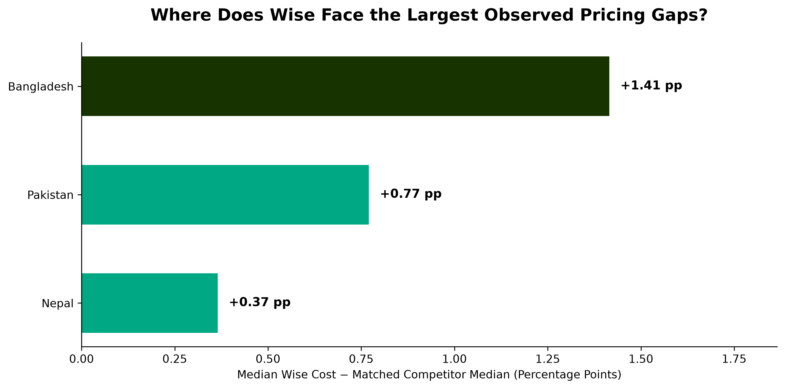

# Wise Remittance Pricing Analysis

**Python | Pandas | NumPy | Matplotlib | Statistical Analysis**

An independent analysis of Wise's historical remittance pricing competitiveness across three UK outbound corridors: **Bangladesh, Pakistan and Nepal (2022–2025)**.

Using World Bank data, I compared Wise's transfer costs against matched competitors, identified pricing anomalies and translated the findings into business recommendations.

📄 **[Executive Report](outputs/reports/Wise_Pricing_Analysis.pdf)** | 💻 **[Python Notebook](notebooks/01_exploratory_analysis.ipynb)** | 📊 **[Dataset Source](https://remittanceprices.worldbank.org/data-download)**

---

## Key Findings

Analysed **98 matched Wise observations**, comparing total transfer costs against the median matched competitor.

| Corridor | Median Pricing Gap | Wise Costlier in |
|---|---:|---:|
| Bangladesh | +1.415 pp | 81.3% |
| Pakistan | +0.770 pp | 63.6% |
| Nepal | +0.365 pp | 81.8% |

*Pricing gap = Wise total cost − median matched competitor cost, in percentage points (pp). Positive values indicate higher Wise costs in the historical matched sample.*

### Pricing Gap by Corridor

## Methodology

- **Data preparation:** Cleaned and filtered World Bank Remittance Prices Worldwide (RPW) data for UK outbound transfers.
- **Competitor benchmarking:** Matched quotes by destination, quarter, payment method and payout method.
- **Anomaly detection:** Identified 7 unusual pricing gaps using robust z-scores.
- **Sensitivity analysis:** Recalculated results excluding anomalies and requiring at least two competitors.

## Business Recommendations

1. **Bangladesh:** Prioritise investigation of pricing differences. The median gap falls to +0.940 pp after excluding anomalies; exchange-rate benchmarks and subsidy treatment require validation.
2. **Pakistan & Nepal:** Monitor recurring pricing differences and investigate payment-method effects.
3. **Competitive monitoring:** Reassess findings using current, like-for-like quotes before recommending pricing changes.

## Dataset & Reproducibility

**Source:** [World Bank — Remittance Prices Worldwide](https://remittanceprices.worldbank.org/data-download)

**Dataset:** `rpw_dataset_2011_2025_q1.xlsx` (excluded from GitHub due to size).

To reproduce:

1. Download the dataset and place it in `data/`.
2. Install dependencies using `pip install -r requirements.txt`.
3. Run `notebooks/01_exploratory_analysis.ipynb`.

*Note: The analysis uses historical observations, not live pricing. Matching improves comparability but does not eliminate all differences between quotes. Bangladesh's FX benchmark methodology requires particular caution.*

---

**Areeba Khaleeq** | MSc Data Science & Analytics, Cardiff University

*Independent portfolio project; not affiliated with Wise.*